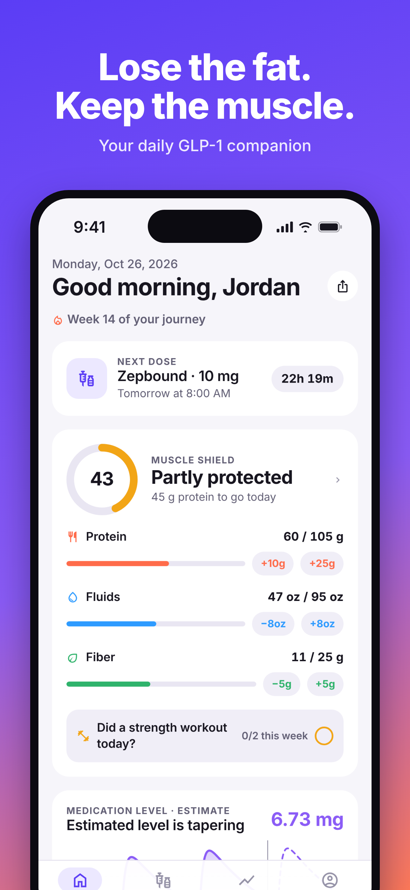
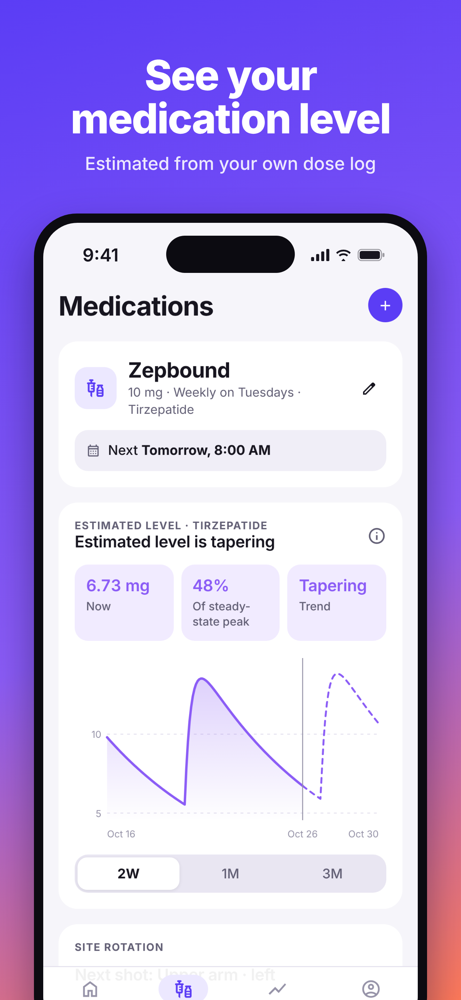
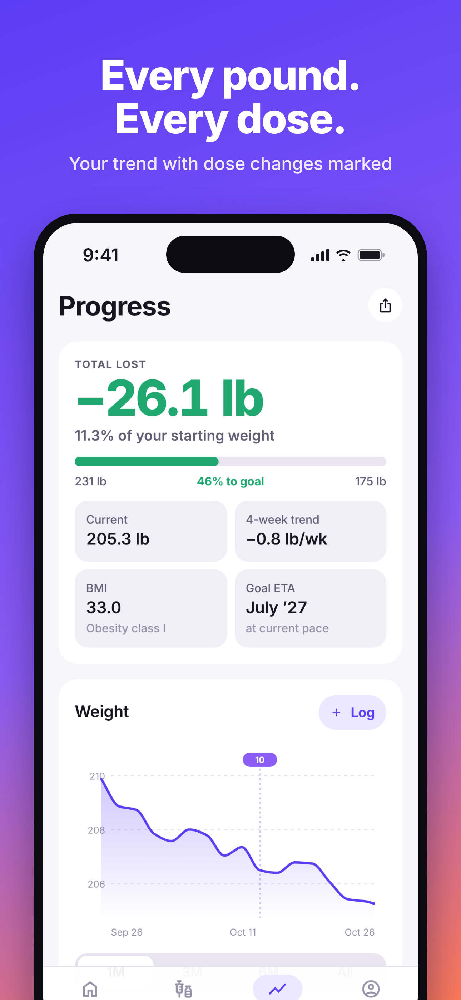
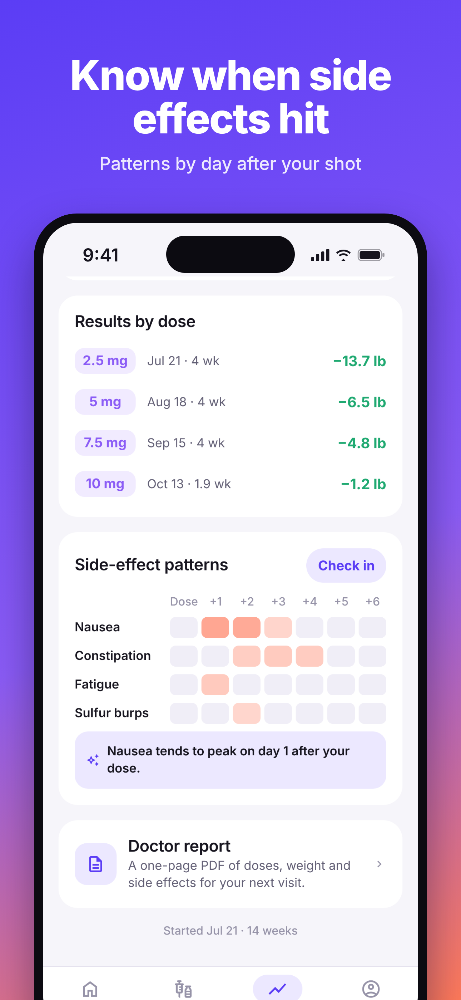

# Lifted: GLP-1 Tracker

**Lose the fat. Keep the muscle.** Lifted is an iOS app (Expo / React Native) for people on GLP-1
medications: Zepbound, Mounjaro, Wegovy (shot, pill and HD), Ozempic, Rybelsus, Foundayo,
Saxenda, Victoza, Trulicity and compounded semaglutide or tirzepatide.

Why this app and this positioning: see [docs/RESEARCH.md](docs/RESEARCH.md).
Shipping it: [docs/LAUNCH.md](docs/LAUNCH.md). Growing it: [docs/GROWTH.md](docs/GROWTH.md).

| Today | Medication level | Progress | Side-effect patterns |
| --- | --- | --- | --- |
|  |  |  |  |

## What's in the app

**Free**
- Dose reminders for any schedule: weekly on a fixed day, daily, every N days, or split doses on
  set weekdays. Early or late shots never create a near-duplicate next dose.
- Shot and pill logging with an injection-site body map that suggests the next site.
- Pill mode: a 30-minute "wait to eat" timer with a notification (Wegovy pill / Rybelsus).
- **Muscle Shield**: a daily 0–100 score from personal protein, fluid, fiber and weekly strength
  targets, with one-tap quick-add.
- Weight logging, total and percent lost, 4-week trend, BMI, goal ETA and milestones.
- A 10-second daily check-in for side effects, food noise and energy, plus contextual tips.
- Shareable progress cards that show percent lost, never your weight.

**Lifted+ (subscription: 7-day free trial, $49.99/yr or $12.99/mo)**
- Estimated medication level chart (a pharmacokinetic model fed by your own dose log).
- Side-effect patterns by day after the dose, and results by dose step.
- Full history (free shows the last 30 days), multiple medications, supply and cost tracking.
- A one-page doctor report PDF and CSV export.

**Conversion flow:** a 17-step personalized onboarding quiz. It can backfill past doses from the
standard titration schedule, builds a plan with a clinical-trial-average projection, primes
notification permission, then shows a paywall with trial timeline and annual/monthly plans.
Locked features show the user's own data dimmed behind a lock, not a generic upsell.

**Privacy:** no account, no analytics, no ads. All health data lives on the device.

## Getting started

```bash
npm install
npm run web                 # quickest preview in a browser
npx expo start              # then press i for an iOS simulator (macOS) or scan with a dev build
```

Web-preview helpers:
- `/?demo=1&premium=1` loads ~14 weeks of realistic demo data with premium unlocked
- `/?reset=1` clears data and restarts onboarding
- The **You** tab has a Developer section (demo data, simulated premium) in dev and web builds

In web previews and dev builds without a RevenueCat key, purchases are **simulated** (the paywall
shows "Test mode"). Production builds never simulate purchases.

### Checks

```bash
npm run typecheck   # TypeScript
npm run lint        # ESLint (expo config + React Compiler rules)
npm test            # Jest: 78 unit tests for the domain logic
npm run check       # all three
```

## Building for the App Store (no Mac needed)

```bash
npx eas-cli@latest login
npx eas-cli@latest init
npx eas-cli@latest build -p ios --profile production
npx eas-cli@latest submit -p ios --latest
```

Before your first submission, work through the checklist in [docs/LAUNCH.md](docs/LAUNCH.md):
Apple Developer account, subscription products, RevenueCat entitlement `premium`, the
`EXPO_PUBLIC_REVENUECAT_IOS_KEY` env var, hosted privacy and terms pages, and the store
listing.

> **Must change before submitting:** `src/constants/brand.ts` still uses placeholder URLs
> (`liftedapp.co`) and a placeholder support email. Also confirm the "Lifted" name is free to use
> (App Store and trademark search).

## Project structure

```
src/
  app/                 Expo Router screens
    (tabs)/            Today, Meds, Progress, You
    onboarding.tsx     personalized quiz → plan → notifications → paywall
    paywall.tsx        subscription screen
    log-dose.tsx, log-weight.tsx, log-symptoms.tsx, medication/[id].tsx,
    share.tsx, report.tsx, targets.tsx, profile.tsx, level-info.tsx
  lib/                 pure, unit-tested domain logic (no React)
    pk.ts              medication-level model (Bateman function + superposition)
    schedule.ts        next-dose, status, adherence, projected doses
    nutrition.ts       targets and the Muscle Shield score
    weight.ts          trend, milestones, dose attribution, results by dose
    symptoms.ts        side-effect patterns and insights
    onboarding.ts      draft → profile/medication/backfilled doses
    report.ts, csv.ts  doctor report HTML and CSV export
    medications.ts     medication catalog, dose ladders, PK parameters, trials
  store/               Zustand store persisted to AsyncStorage, selectors, demo data
  services/            notifications, purchases (RevenueCat), export, haptics, review
  components/          UI kit, charts (SVG), feature components
  constants/           theme tokens, brand config
assets/source/         icon SVGs and render script (node assets/source/render-icons.js)
store/                 App Store screenshot generator and output
docs/                  research, launch kit, growth plan, privacy and terms drafts
```

## Medical and App Review notes

- The app **never calculates or recommends doses** (Apple Guideline 1.4.2). Users enter what
  their prescriber gave them.
- The level chart, nutrition targets and trial projection are labeled as estimates, and their
  methodology is shown in-app (You → How estimates work).
- Pharmacokinetic parameters and trial results are in `src/lib/medications.ts`, with sources.
